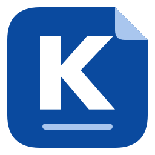
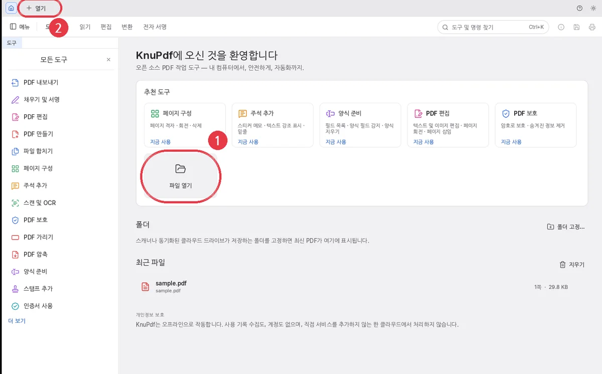
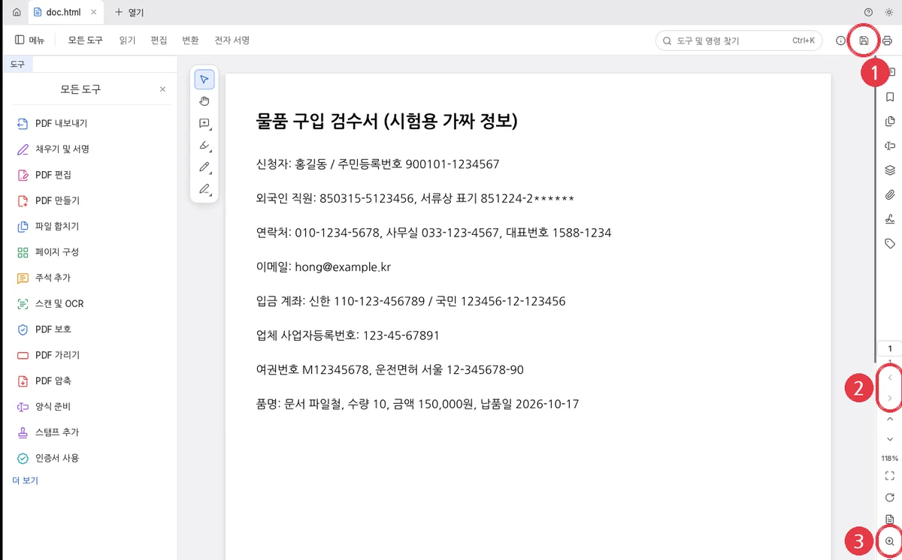
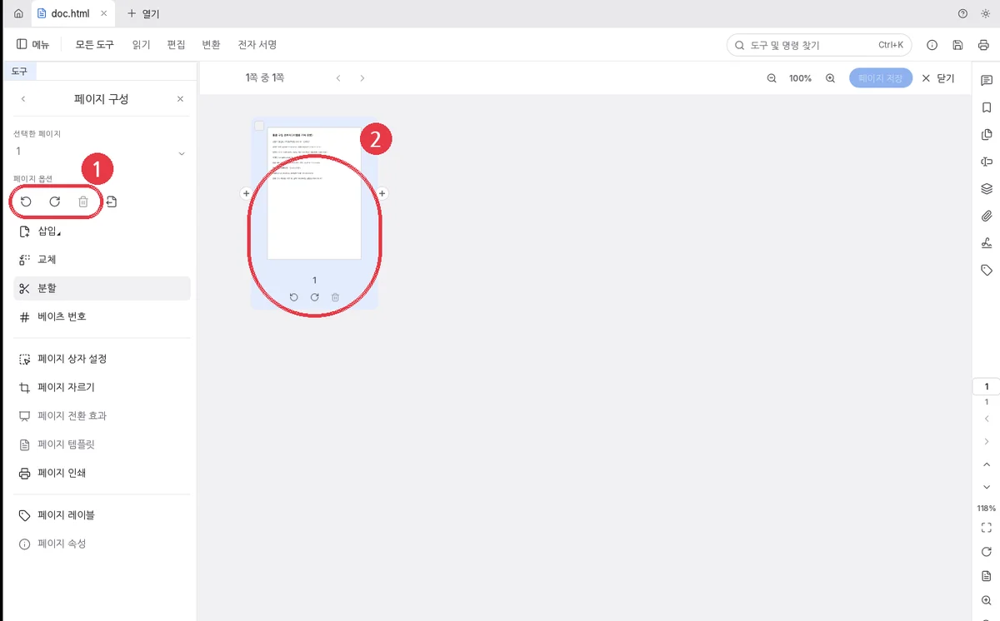
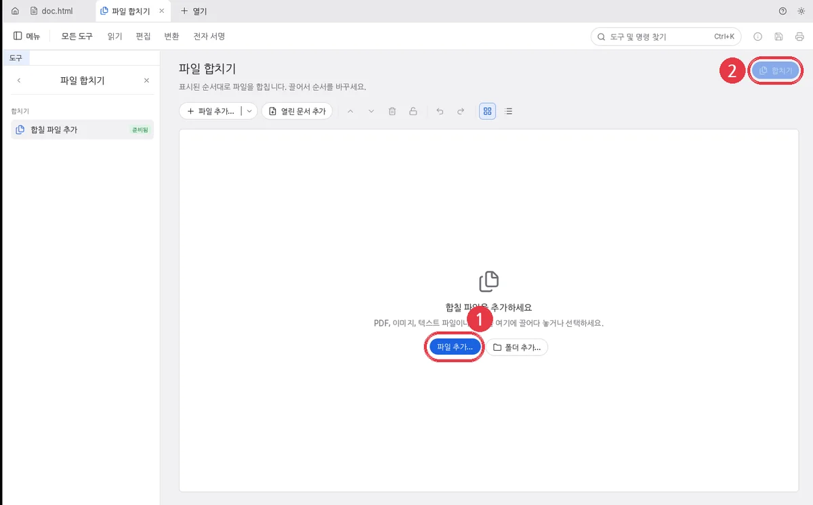
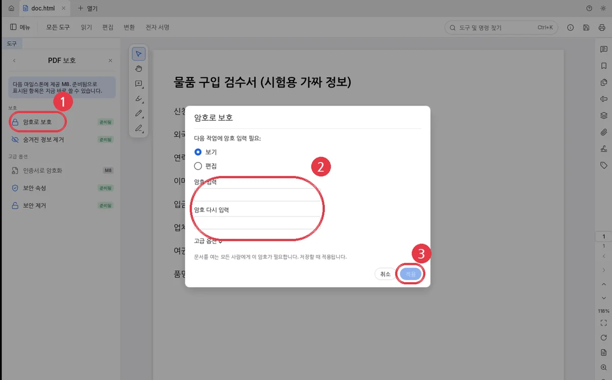
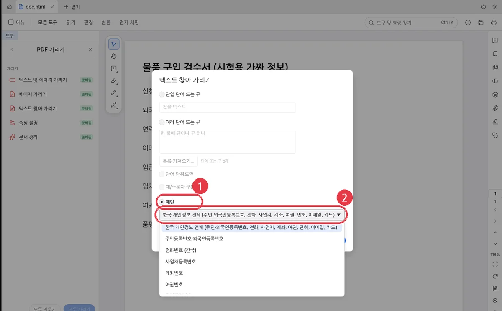
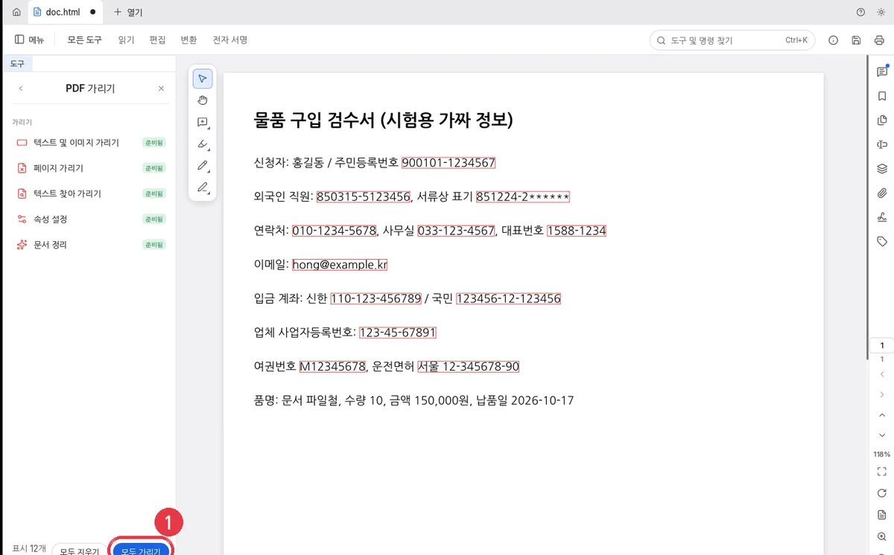
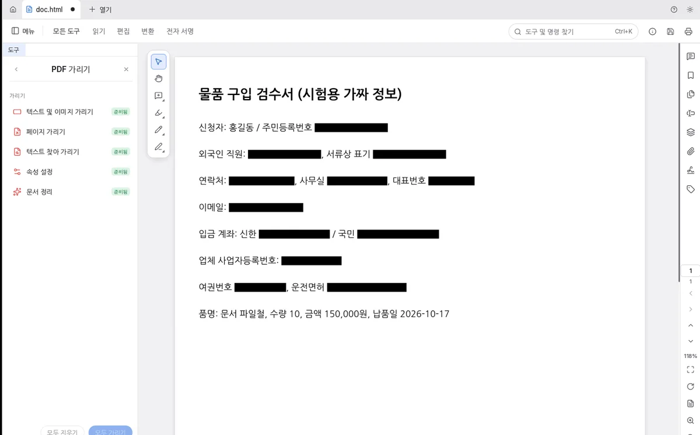
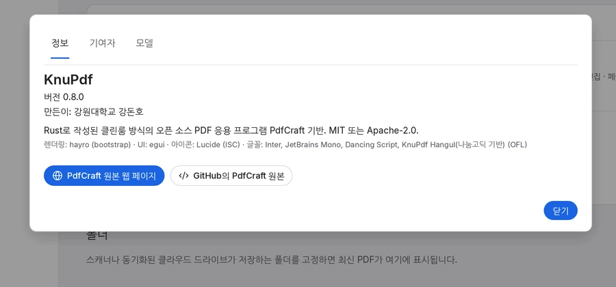

# KnuPdf 쉬운 사용 설명서

PDF를 열고, 보고, 고치고, 지키는 방법을 하나씩 따라 해 봐요.
그림 속 **빨간 동그라미 번호** 순서대로 누르면 돼요.

> 같은 내용을 예쁘게 꾸민 페이지: [`index.html`](index.html)
> (저장소를 내려받은 뒤 브라우저로 열어요)

## KnuPdf가 뭐예요?

**PDF**는 종이 문서를 컴퓨터 안에 그대로 담은 파일이에요. 학교 가정통신문, 안내문, 신청서가 PDF로 많이 와요.

**KnuPdf**는 이 PDF를 열어 보고, 페이지를 돌리거나 합치고, 비밀번호를 걸고, 개인정보를 지울 수 있는 프로그램이에요.
인터넷에 파일을 보내지 않고 **내 컴퓨터 안에서만** 일해서 안전해요.

**준비물**: Windows 10 또는 11 컴퓨터 · KnuPdf 설치 파일(`KnuPdf-0.8.0-windows-x64-setup.exe`) · 연습할 PDF 파일 한 개

**미션 목록**
1. [설치하기](#미션-1-컴퓨터에-설치하기)
2. [PDF 열기](#미션-2-knupdf-켜고-pdf-열기)
3. [크게 보고 넘기기](#미션-3-크게-보고-페이지-넘기기)
4. [페이지 돌리기·지우기](#미션-4-페이지-돌리기지우기)
5. [PDF 합치기](#미션-5-여러-pdf를-하나로-합치기)
6. [비밀번호 걸기](#미션-6-비밀번호-걸기)
7. [개인정보 지우기](#미션-7-개인정보-한-번에-지우기)
8. [저장하기](#미션-8-저장하기)
9. [도움이 필요해요](#이럴-땐-어떻게-해요)

---

## 미션 1. 컴퓨터에 설치하기

한 번만 하면 돼요. 처음이라면 어른과 함께 해요.

1. **KnuPdf-0.8.0-windows-x64-setup.exe** 파일을 마우스로 **두 번 딸깍** 눌러요.
2. 파란 창에 "Windows의 PC 보호"가 나오면 **[추가 정보]**를 누르고, 아래에 생기는 **[실행]**을 눌러요.
3. "이 앱이 디바이스를 변경하도록 허용하시겠어요?"가 나오면 **[예]**를 눌러요.
4. 설치 창에서 **[다음]**을 계속 누르고, 마지막에 **[설치]**, 그다음 **[마침]**을 눌러요.
5. 바탕 화면에 **파란 네모 K** 아이콘이 생기면 성공이에요.

> **왜 파란 경고 창이 나와요?**
> KnuPdf는 새로 만든 프로그램이라 Windows가 아직 잘 몰라서 조심하라고 알려 주는 거예요.
> 학교나 회사 컴퓨터라면 컴퓨터 담당 선생님께 먼저 여쭤봐요.

## 미션 2. KnuPdf 켜고 PDF 열기

1. 바탕 화면의 **K 아이콘**을 두 번 눌러 KnuPdf를 켜요.
2. 가운데 **[파일 열기]**(그림의 1번)나, 맨 위 **[+ 열기]**(2번)를 눌러요.
3. 열고 싶은 PDF를 골라 **[열기]**를 눌러요.

> **더 쉬운 방법**: PDF 파일을 마우스로 꾹 눌러 KnuPdf 창 위로 **끌어다 놓아도** 열려요.
> 한 번 연 파일은 첫 화면 "최근 파일"에 남아서 다음에 바로 열 수 있어요.

## 미션 3. 크게 보고, 페이지 넘기기

1. 오른쪽의 **위·아래 화살표**(그림의 2번)를 누르면 앞 페이지, 다음 페이지로 가요.
2. **돋보기**(3번)를 누르면 글자가 크게 보여요. `Ctrl`을 누른 채 마우스 휠을 굴려도 돼요.
3. 1번 **저장** 단추는 미션 8에서 써요.

## 미션 4. 페이지 돌리기·지우기

옆으로 누운 페이지를 바로 세우거나, 필요 없는 페이지를 뺄 때 써요.

1. 왼쪽 도구 목록에서 **[페이지 구성]**을 눌러요.
2. 위쪽 단추(그림의 1번)로 고른 페이지를 **왼쪽·오른쪽으로 돌리거나** **휴지통**으로 지워요.
3. 가운데 페이지 그림(2번) 아래의 작은 단추로도 한 장씩 돌리고 지울 수 있어요.

> **실수했어요!** 괜찮아요. `Ctrl` + `Z`를 누르면 방금 한 일이 취소돼요.

## 미션 5. 여러 PDF를 하나로 합치기

1. 왼쪽 도구 목록에서 **[파일 합치기]**를 누르고, **[합칠 파일 추가]**를 눌러요.
2. **[파일 추가…]**(그림의 1번)를 눌러 합칠 PDF들을 골라요. 파일을 이 칸에 끌어다 놓아도 돼요.
3. 파일 순서를 마우스로 끌어서 바꿔요. 위에 있는 파일이 앞쪽 페이지가 돼요.
4. 오른쪽 위 **[합치기]**(2번)를 누르면 새 PDF 하나가 만들어져요.

## 미션 6. 비밀번호 걸기

비밀번호를 아는 사람만 PDF를 열 수 있게 해요.

1. 왼쪽 도구 목록에서 **[PDF 보호]**를 누르고, **[암호로 보호]**(그림의 1번)를 눌러요.
2. "보기"가 골라진 채로, **암호 입력**과 **암호 다시 입력** 칸(2번)에 같은 비밀번호를 두 번 써요.
3. **[적용]**(3번)을 누르고, 꼭 **저장**(미션 8)까지 해요. 저장해야 비밀번호가 걸려요.

> ⚠️ **꼭 기억해요**: 비밀번호를 잊어버리면 아무도 그 PDF를 열 수 없어요.
> 비밀번호는 안전한 곳에 적어 두고, 다른 친구에게 알려 주지 않아요.

## 미션 7. 개인정보 한 번에 지우기

주민등록번호, 전화번호, 계좌번호, 이메일처럼 남이 보면 안 되는 정보를 찾아서 **검은 상자로 완전히** 지워요.

1. 왼쪽 도구 목록에서 **[PDF 가리기]**를 누르고 **[텍스트 찾아 가리기]**를 눌러요.
2. 창이 뜨면 **[패턴]**(그림의 1번)을 고르고, 목록(2번)에서 **한국 개인정보 전체**를 그대로 둬요.
   주민등록번호만, 전화번호만처럼 하나만 고를 수도 있어요.
3. **[모두 표시]**를 누르면 찾은 곳에 **빨간 테두리**가 생겨요. 아직 지워지지 않았으니 잘 찾았는지 눈으로 확인해요.
4. 왼쪽 아래 **[모두 가리기]**를 누르고, 확인 창에서 **[적용]**을 눌러요. 빨간 테두리가 **검은 상자**로 바뀌면 지워진 거예요.
5. **다른 이름으로 저장**(미션 8)해요.

| 찾은 곳: 빨간 테두리 → 1번 **[모두 가리기]** | 다 지운 모습: 검은 상자 |
|---|---|
|  |  |

> ⚠️ **되돌릴 수 없어요**: 적용하고 저장하면 지운 글자는 다시 살릴 수 없어요.
> 그래서 원래 파일은 그대로 두고, **다른 이름으로 저장**해서 새 파일을 만들어요.

> **사진 속 글자는 못 찾아요**: 종이를 스캔한 사진 같은 PDF는 글자가 그림이라 찾지 못해요.
> 그럴 때는 **[텍스트 및 이미지 가리기]**로 지울 곳을 마우스로 직접 네모나게 그려요.

## 미션 8. 저장하기

1. 지금 파일에 그대로 저장하려면 오른쪽 위 **저장 단추**(미션 3 그림의 1번)를 누르거나 `Ctrl` + `S`를 눌러요.
2. 새 파일로 따로 저장하려면 **[메뉴] → [파일] → [다른 이름으로 저장…]**(또는 `Ctrl` + `Shift` + `S`)을 눌러 새 이름을 써요.
3. 탭 이름 옆에 **까만 점**이 있으면 아직 저장하지 않은 거예요. 저장하면 점이 사라져요.

## 이럴 땐 어떻게 해요?

화면 글자가 영어로 나와요.

**[메뉴] → [편집] → [환경설정…]**(또는 `Ctrl` + `,`)을 열고 **표시 언어**를 **한국어**로 골라요.

방금 한 걸 취소하고 싶어요.

`Ctrl` + `Z`를 눌러요. 다시 하고 싶으면 `Ctrl` + `Shift` + `Z`예요.

도구를 못 찾겠어요.

맨 위 **도구 및 명령 찾기** 칸(`Ctrl` + `K`)에 "회전", "합치기", "암호"처럼 하고 싶은 일을 써 보세요.

설치하지 않고 쓸 수 있나요?

네. 설치 없이 쓰는 **휴대용 zip**이 있어요. 압축을 풀고 **KnuPdf.exe**를 실행해요.
인터넷 브라우저에서 쓰는 웹판도 있어요(관리자가 알려 주는 주소로 접속).

프로그램 버전과 만든 사람이 궁금해요.

**[메뉴] → [도움말] → [KnuPdf 정보]**를 눌러요.

## 우리의 약속

다른 사람의 이름, 주민등록번호, 전화번호는 그 사람의 소중한 비밀이에요.
친구나 가족의 정보가 담긴 PDF를 다른 사람에게 보낼 때는 먼저 미션 7로 지우고 보내요.

---

화면 그림은 KnuPdf 0.8.0 Windows판에서 찍었어요. 그림 속 이름·번호는 모두 연습용 가짜 정보예요.
